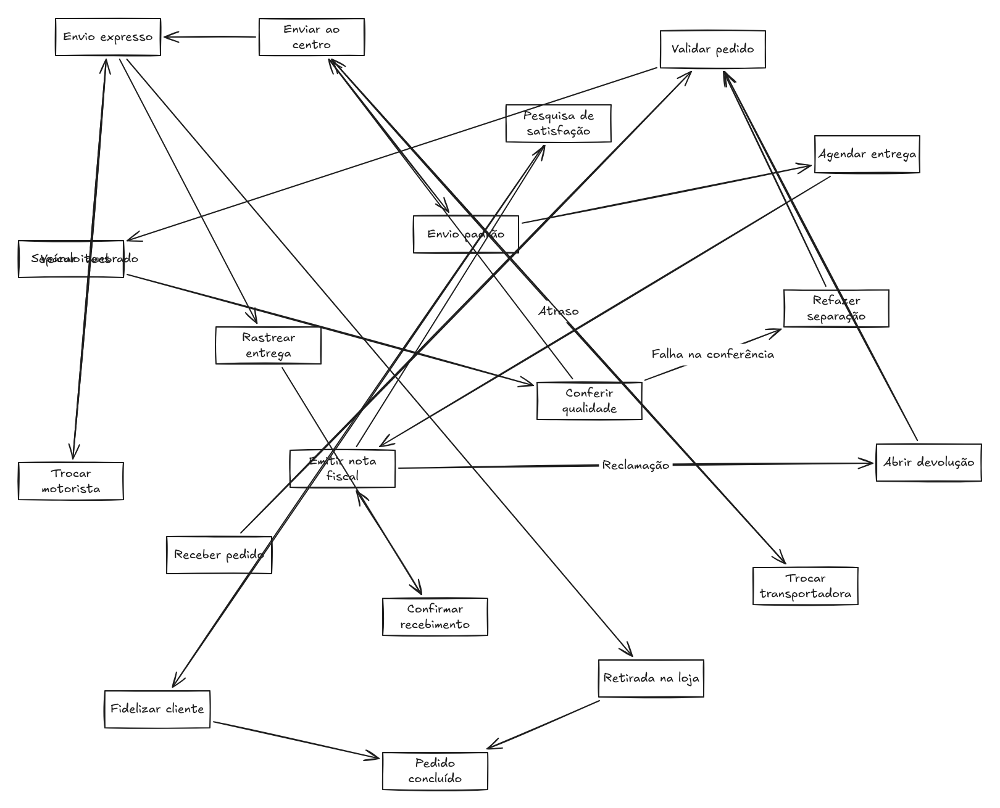
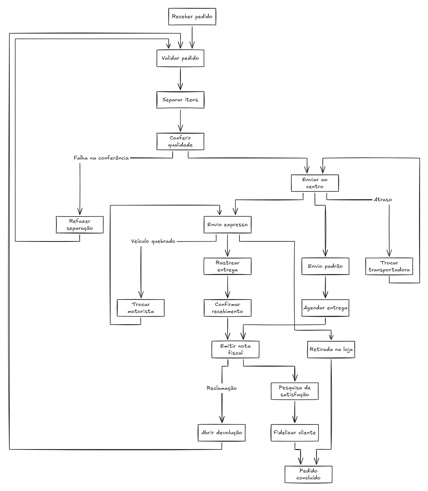
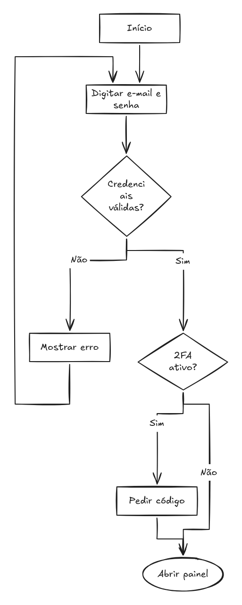
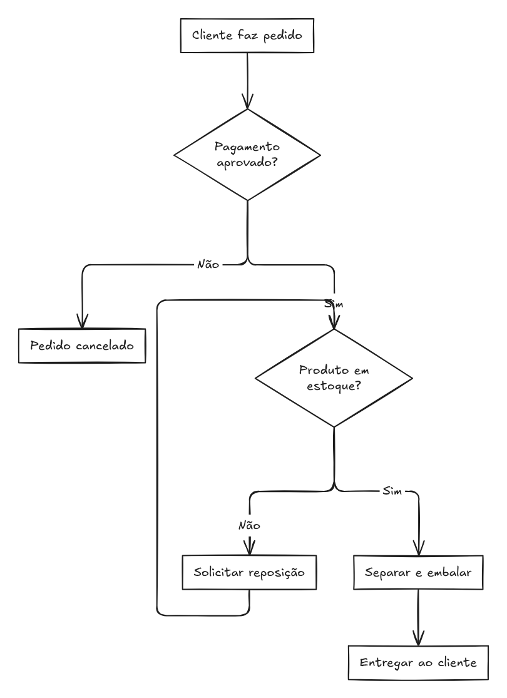
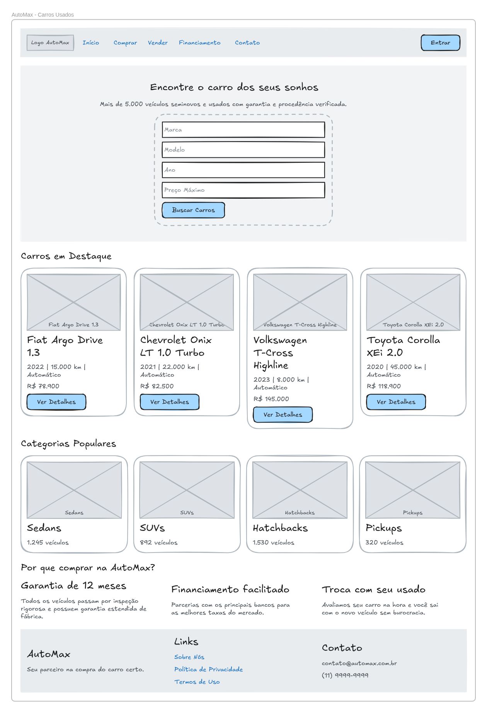
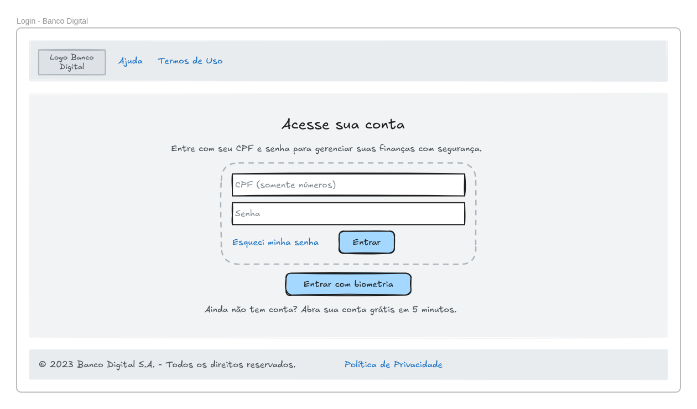
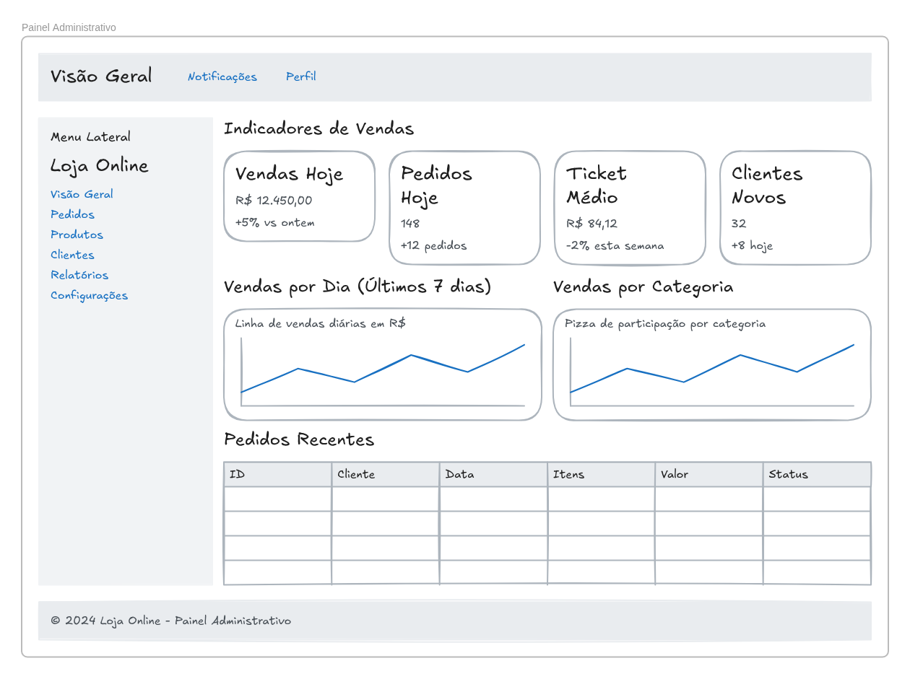
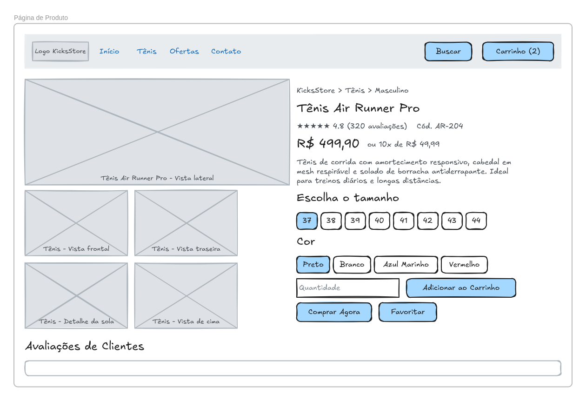

# IA local no Excalidraw — registro das fases

Fork pessoal, branch `ia-local`. Base: `excalidraw/excalidraw` commit `82d5847e5` (12/11/2026). Nada daqui é enviado ao repositório oficial.

## Fase 0 — Preparação e medição (12/11/2026)

### Ambiente medido

- PC: Ryzen 7 7700X, 32 GB DDR5, RTX 3090 24 GB.
- LLM: `llama-server` (llama.cpp b12018) em `http://127.0.0.1:9931/v1`, com `Qwen3.8-27B-UD-Q4_K_S`, 128k de contexto, 2 slots e decodificação especulativa MTP. Ocupa ~22 GB da GPU.
- App: `corepack yarn install --frozen-lockfile` e `vite` em `http://127.0.0.1:3001`.

### Como foi medido

Script: [`bench/bench.py`](bench/bench.py). Cada caso foi rodado uma vez, por streaming na API OpenAI do llama-server.

- Os fluxogramas usam um prompt de sistema que pede só Mermaid.
- Os wireframes usam `response_format: json_schema`, com uma árvore de blocos de tipos fixos e sem posições.
- O raciocínio foi alternado com `chat_template_kwargs.enable_thinking`.

As saídas brutas estão em `bench/saidas-*`.

### Resultados

| Caso | Sem raciocínio: total | Com raciocínio: total (1º texto útil) | Tokens gerados (sem / com) | Válido? |
| --- | --- | --- | --- | --- |
| Fluxograma de login | **1,5 s** | 6,3 s (5,5 s) | 86 / 464 | sim / sim |
| Fluxograma de compra | **1,5 s** | 7,0 s (6,2 s) | 93 / 500 | sim / sim |
| Sequência de pedido | **2,1 s** | 6,8 s (5,5 s) | 142 / 492 | sim / sim |
| Wireframe: site de carros | **13,4 s** (53 blocos) | 60,8 s (43,6 s) (60 blocos) | 1182 / 4845 | sim / sim |
| Wireframe: login de banco | **3,2 s** (10 blocos) | 21,4 s (19,0 s) (9 blocos) | 247 / 1470 | sim / sim |

- Velocidade de geração: ~83–92 tokens/s sem raciocínio e ~70–80 tokens/s com raciocínio. O primeiro token chega em ~0,4–0,55 s.
- **"Válido"** quer dizer:
  - Mermaid: os 3 diagramas sem raciocínio foram convertidos sem erro pelo `parseMermaidToExcalidraw` do próprio app, no navegador.
  - Wireframe: JSON aceito e com `root`.
- O esquema JSON funciona com o raciocínio ligado (a gramática só começa depois do raciocínio).

### Conclusões para as próximas fases

1. **Raciocínio desligado por padrão.** A qualidade foi equivalente nestes casos e a resposta saiu 4 a 5 vezes mais rápida. Pode virar uma opção "pensar mais" se algum caso precisar.
2. **O plano B da 2b já é o plano A.** O modelo descreve só a estrutura, com um conjunto fixo de blocos forçado pelo esquema; o nosso código calcula as posições.
3. **Problemas a corrigir no prompt e no esquema** (Fase 1 e Fase 3):
   - No diagrama de sequência, o modelo pôs aspas no apelido do participante (`participant X as "Banco de Dados"`), e as aspas aparecem no desenho. Isso foi causado pelo nosso prompt; ajustar a instrução.
   - Em um wireframe, a raiz veio como `nav` em vez de `page`. O esquema deve fixar a raiz como `page`.
   - O tipo `heading` não foi usado: o modelo usou `text` para títulos. Avaliar se vale manter os dois.
4. Os tempos são do PC forte. A Fase 7 mede máquinas modestas.

### Antes da mudança


Em modo de desenvolvimento, o "Texto para diagrama" chama `http://localhost:3016`, que não existe, e mostra "Error: Failed to fetch".

## Fase 1 — IA local no "Texto para diagrama" (12/11/2026)

### O que mudou

- **Novo cliente** [`excalidraw-app/ai/localLLM.ts`](../excalidraw-app/ai/localLLM.ts):
  - Fala com qualquer servidor compatível com a API de chat da OpenAI (llama.cpp, Ollama, LM Studio), direto do navegador, sem backend nem proxy.
  - Prompt de sistema próprio (só Mermaid, rótulos no idioma do pedido) e raciocínio desligado.
  - Converte o streaming `choices[0].delta.content` para o formato que o diálogo espera.
  - Limpa cercas ` ``` ` e blocos `<think>` ainda durante o streaming.
  - Erros claros: servidor fora do ar, erro HTTP, resposta vazia, cancelamento.
- **[`excalidraw-app/components/AI.tsx`](../excalidraw-app/components/AI.tsx)**: o diálogo passa a usar o cliente local no lugar do backend do excalidraw.com. O "Wireframe para código" continua como estava.
- **Selo "IA local · modelo @ host"** no cabeçalho do chat ([`LocalAIStatus.tsx`](../excalidraw-app/components/LocalAIStatus.tsx)):
  - Bolinha verde ou vermelha conforme a conexão.
  - Painel para trocar o endereço e o modelo, com "Testar conexão" e "Restaurar padrão". A escolha fica salva no `localStorage`.
- **Pacote do editor**:
  - Nova prop opcional `renderChatHeader` no `TTDDialog`, para o app mostrar o selo.
  - **Correção de um defeito do próprio Excalidraw** em [`useMermaidRenderer.ts`](../packages/excalidraw/components/TTDDialog/hooks/useMermaidRenderer.ts). Se a resposta terminava enquanto a pré-visualização ainda desenhava um trecho parcial, a versão final era descartada: a pré-visualização e o "Inserir" ficavam só com os primeiros nós. Com o servidor deles, lento, isso quase nunca acontece; com o Qwen local (~1,5 s por fluxograma), acontecia sempre. Agora o último pedido pendente é desenhado quando o anterior termina.
- **Configuração**:
  - `VITE_APP_LOCAL_LLM_URL` e `VITE_APP_LOCAL_LLM_MODEL` em `.env.development` e `.env.production`. O padrão é o Ollama (`http://127.0.0.1:11434/v1`).
  - Na máquina de desenvolvimento, `.env.development.local` (fora do git) aponta para o llama.cpp em `:9931`.
- **Textos** em inglês e português (`localAI.*` nos arquivos de idioma).

### Verificação

- **Testes automáticos:**
  - 16 testes novos em `excalidraw-app/ai/localLLM.test.ts` cobrem streaming, limpeza, configuração, modelo automático, servidor fora do ar, erro HTTP, 429, resposta vazia e cancelamento.
  - Os testes existentes do diálogo, do Mermaid e do app continuam passando (154 no total).
  - Typecheck e ESLint sem erros.
- **No navegador** (painel do Claude Code, Chromium):
  - Fluxograma de compra gerado e desenhado completo (8 etapas, decisão e laço).
  - Ajuste no mesmo chat ("adicione nota fiscal antes do envio") funcionou.
  - Endereço errado: selo vermelho e mensagem clara no chat.
  - Diagramas de sequência e de estados gerados sem as aspas que apareciam na fase 0.
  - Nas requisições observadas, só houve chamadas para `127.0.0.1`.
- **Validação humana no Firefox (12/11/2026, 23:42): aprovada.**
  - Três fluxogramas gerados e inseridos no quadro.
  - O da esquerda ("comprar GTA 6": 4 decisões, 7 desfechos que convergem) foi feito **com a internet desligada**.
  - Os outros dois foram feitos com a internet ligada.


## Fase 1b — Prompt mais rico e correção de formas (13/11/2026)

Na validação da Fase 1 apareceu um problema: pedidos curtos ("fluxograma de entrega") viravam fluxogramas em linha reta.

### O que mudou

- **Prompt de sistema** ([`localLLM.ts`](../excalidraw-app/ai/localLLM.ts)):
  - Pede o processo "como acontece de verdade", não só o caminho feliz: pontos de decisão naturais (validações, aprovações, disponibilidade, sucesso ou falha), o que acontece em cada saída e laços de volta quando algo precisa ser refeito.
  - Toda decisão tem pelo menos duas saídas rotuladas e não pode haver beco sem saída.
  - Meta de 8 a 16 nós; linha reta só quando o processo não tem escolhas.
  - Se o usuário descrever os passos, o modelo segue a descrição sem inventar etapas.
- **Correção determinística das formas** (`fixFlowchartShapes`), aplicada a cada linha completa do fluxograma ainda durante o streaming:
  - colchetes trocados: `H["Cliente satisfeito?"}` vira `H{...}`. Esse erro quebrava o diagrama (1 em 12 respostas no primeiro teste);
  - pergunta desenhada como passo: `B["Pagamento aprovado?"]` vira losango `B{...}`.
- O texto passa a ser mostrado linha a linha durante a geração (antes saía caractere a caractere), o que permite corrigir cada linha antes de ela aparecer.

### Comparação (A = prompt da fase 1, B = prompt novo)

Foram 6 pedidos curtos, 3 gerações de cada com cada prompt (36 no total), com o script [`bench/prompt_ab.py`](bench/prompt_ab.py). As saídas estão em [`bench/prompt-ab-resultado.json`](bench/prompt-ab-resultado.json).

|  | A (fase 1) | B (novo) |
| --- | --- | --- |
| Nós por fluxograma (média) | 10,1 | 13,4 |
| Losangos de decisão desenhados (média, após a correção) | 1,8 | 3,2 |
| Laços (setas para trás) | 1,1 | 2,1 |
| Fluxogramas sem nenhuma decisão | 3 de 18 | 1 de 18 |
| Tempo médio | 1,8 s | 2,5 s |
| Válidos no conversor do Excalidraw (após a correção) | 18 de 18 | 18 de 18 |

Decisões por pedido (`{...}` na resposta crua, 3 gerações):

| Pedido                           | A       | B       |
| -------------------------------- | ------- | ------- |
| Entrega de pedido de loja online | 0, 0, 0 | 3, 3, 4 |
| Contratação de funcionário       | 4, 3, 4 | 4, 4, 5 |
| Login de aplicativo              | 2, 2, 1 | 3, 2, 3 |
| Café na cafeteira                | 1, 1, 1 | 2, 4, 0 |
| Suporte técnico de internet      | 1, 2, 2 | 4, 4, 4 |
| Empréstimo de livro              | 2, 2, 2 | 3, 3, 2 |


### Verificação

- 30 testes do cliente: 14 novos para a correção de formas e o streaming linha a linha, mais os 16 da Fase 1.
- Os testes do diálogo e do app continuam passando, sem erros de typecheck e de lint.
- No navegador do painel, o pedido curto de entrega gerou 3 decisões em losango e um laço.
- Falta a sua validação no Firefox.

### Incidente durante o desenvolvimento (sem impacto no código)

O servidor do Vite chegou a guardar em cache uma versão vazia de `localLLM.ts`, lida no meio de uma regravação do formatador. Um `touch` no arquivo resolveu. Se o diálogo parar de responder logo depois de editar arquivos, recarregue a página ou reinicie o `yarn start`.

## Fase 2 — "Organizar": layout automático do diagrama (13/11/2026)

Seleciona-se um diagrama bagunçado e ele se rearruma sozinho, com as setas presas às caixas. Não usa IA: usa o algoritmo de layout em camadas do **ELK** (Eclipse Layout Kernel, via [elkjs](https://github.com/kieler/elkjs) 0.12.1, licença EPL-2.0, sem modificação, carregado só no primeiro uso). Responde à issue [excalidraw/excalidraw#11039](https://github.com/excalidraw/excalidraw/issues/11039).

### Como usar

- **Menu de contexto** (botão direito na seleção): "Organizar diagrama".
- **Painel de propriedades**: o botão com ícone de hierarquia, logo abaixo dos botões de alinhar e distribuir.
- **Atalho**: Shift+Alt+O (aparece também na ajuda de atalhos).
- **Paleta de comandos** (Ctrl+/): "Organizar diagrama", "Organizar diagrama de cima para baixo" e "Organizar diagrama da esquerda para a direita".

Sem direção fixa, ele mantém a orientação do diagrama quando ela é clara (setas 1,5 vez mais horizontais do que verticais viram layout horizontal). Caso contrário, organiza de cima para baixo, como num fluxograma.

### Como funciona

- [`packages/element/src/organize.ts`](../packages/element/src/organize.ts), sem dependências:
  - **Monta o grafo:** cada caixa ou grupo selecionado é um nó (com o texto de dentro). Cada seta ligada a dois nós é uma aresta, mesmo que a seta não esteja selecionada.
  - **Aplica as posições** ancorando o resultado onde o diagrama estava.
  - **Setas retas:** seguem as rotas do ELK, em ângulo reto e contornando as outras caixas, com as pontas presas onde a rota encontra a caixa.
  - **Setas em cotovelo** (as do Mermaid e da IA): recebem os lados de saída e chegada escolhidos pelo ELK, e o roteador do próprio Excalidraw refaz o caminho.
- [`packages/excalidraw/organize/elkLayout.ts`](../packages/excalidraw/organize/elkLayout.ts) — opções do ELK:
  - camadas;
  - laços quebrados por busca em profundidade, para que só as setas de retorno subam;
  - rótulos "Sim/Não" sobre a própria seta;
  - setas saindo de um ponto único de cada lado, como num fluxograma desenhado à mão.
- [`packages/excalidraw/actions/actionOrganize.tsx`](../packages/excalidraw/actions/actionOrganize.tsx) — a ação (três variantes):
  - um único passo de desfazer;
  - aviso se o ELK não carregar.

### Antes e depois

Fluxograma de login espalhado de propósito (7 caixas, 2 decisões, 1 laço). O script [`demo/organizeDemo.js`](demo/organizeDemo.js) monta esse diagrama no app em modo de desenvolvimento.


Fluxograma gerado pelo Mermaid (setas em cotovelo), com as caixas embaralhadas e depois organizadas:


### Verificação

- **13 testes novos** ([`packages/excalidraw/tests/organize.test.tsx`](../packages/excalidraw/tests/organize.test.tsx)):
  - grafo da seleção: setas não selecionadas, setas para fora da seleção, seta com rótulo, grupos;
  - escolha da direção;
  - layout sem sobreposição;
  - setas presas e encostadas nas caixas;
  - texto dentro da caixa;
  - nenhuma seta atravessa outra caixa;
  - só o laço sobe;
  - ciclos e partes desconectadas;
  - a ação no editor, com desfazer e refazer.
- **No app**, sobre o fluxograma de login:
  - nenhuma sobreposição;
  - as 8 setas presas (a até 6 px da caixa, que é a folga normal da ligação);
  - desfazer volta exatamente às posições anteriores e refazer reaplica.
- **Defeito encontrado pelos testes e corrigido:** uma seta com rótulo selecionada era tratada como caixa.
- **Falta você validar no Firefox.**

### Limitações conhecidas

- Quando um laço volta para uma decisão (ex.: "Solicitar reposição → Produto em estoque?"), a seta de retorno chega pela mesma ponta de onde saem as outras e fica pouco visível.
- Setas curvas desenhadas à mão viram rotas em ângulo reto ao organizar.
- Quadros (frames) na seleção desativam a ação, como já acontece com alinhar e distribuir.

## Fase 2b — "Organizar" legível em diagramas grandes (13/11/2026)

No teste da Fase 2 no Firefox, com um diagrama de 19 caixas, apareceram quatro problemas: setas umas sobre as outras, setas de retorno sem dar para ver de onde voltam, nomes sobre as linhas e um segundo "Organizar" que ainda mudava o desenho.

### Como medimos

- **Diagrama de teste:** reproduzimos a mesma estrutura do diagrama testado à mão, com rótulos neutros de logística: 19 caixas, 2 laços de volta a um passo anterior, 2 pares de ida e volta e setas com rótulo. O teste de login também entra na comparação.
- **Métricas** ([`packages/excalidraw/tests/helpers/organizeQuality.ts`](../packages/excalidraw/tests/helpers/organizeQuality.ts)), cada uma ligada a um problema relatado:

| Métrica | Problema relatado |
| --- | --- |
| px de seta correndo sobre outra seta | "setas uma em cima da outra" |
| setas que chegam no mesmo ponto onde outra chega ou sai | "não dá para ver para onde está indo" / laço escondido |
| rótulos sobre uma linha ou caixa | "nomes em cima das linhas" |
| quanto uma caixa se move numa segunda execução | "clicando de novo ele muda mais uma vez" |
| setas atravessando caixas e caixas sobrepostas | (já zeradas na fase 2; mantidas como garantia) |

### Resultados

|  | Fase 2 (commit `fase-2`) | Fase 2b |
| --- | --- | --- |
| **Diagrama grande:** setas sobrepostas | 1517 px | **0** |
| **Diagrama grande:** setas com ponta compartilhada | 12 | **0** |
| **Diagrama grande:** rótulos sobre linhas | 1 | **0** |
| **Diagrama grande:** movimento numa 2ª execução | 923 px | **0** |
| **Login:** setas sobrepostas | 181 px | 83 px (\*) |
| **Login:** setas com ponta compartilhada | 4 | 2 (\*) |
| **Login:** movimento numa 2ª execução | 0 | 0 |
| Setas atravessando caixas, caixas sobrepostas | 0 | 0 |

(\*) De propósito: o "Sim" e o "Não" saem juntos da ponta do losango e se separam logo abaixo, e as duas setas que chegam à elipse final se juntam na ponta dela.

Esses números ficam travados em [`organizeQuality.test.tsx`](../packages/excalidraw/tests/organizeQuality.test.tsx): se uma mudança futura piorar a legibilidade, o teste falha.

### O que mudou

1. **Cada seta com seu próprio caminho.** A opção que juntava as setas num ponto só por lado (`mergeEdges`), escolhida na Fase 2 para tirar os trechos soltos nos losangos, foi desligada. Ela era a causa das sobreposições nos diagramas grandes. Agora há espaço mínimo entre linhas paralelas e entre linhas e caixas.
2. **Laços visíveis.** As setas de volta a um passo anterior ganham rota própria (`feedbackEdges`), por fora do fluxo, chegando à caixa por um ponto separado.
3. **Losangos e elipses pelas pontas.** As setas saem da ponta de baixo (ou da direita, no layout horizontal) e chegam pela ponta de cima, como num fluxograma desenhado à mão (portas fixas do ELK). Isso resolve os trechos soltos sem juntar as setas das caixas retangulares.
4. **Mesmo resultado ao organizar de novo.** A ordem de desempate do layout deixou de ser a posição na tela e passou a ser o próprio fluxo: busca em profundidade a partir das caixas sem setas chegando. Organizar um diagrama já organizado não muda nada.
5. **Rótulos:** com as mudanças acima, a métrica de rótulos sobre linhas ficou em zero. Por isso não mexemos no posicionamento dos rótulos, que continua sendo o do Excalidraw: no meio do trajeto da seta.

### Antes e depois (diagrama grande, de cima para baixo)









### Limitações que continuam

- Um rótulo pode encostar de leve numa linha que passa perto, como o "Sim" do Mermaid ao lado do laço. Não houve sobreposição nas métricas, mas não é impossível.
- Várias setas chegando à mesma elipse ou ao mesmo losango se juntam na ponta de cima.

## Fase 3 — Texto vira wireframe de interface (13/11/2026)

Uma terceira aba no diálogo, **"Wireframe"**: você descreve uma tela ("página de produto de uma loja de tênis") e recebe um wireframe editável dentro de um quadro (frame) do Excalidraw.

### Como funciona

- **A IA descreve só a estrutura.** O Qwen devolve uma árvore de blocos de um **conjunto fixo**, sem posições, tamanhos nem cores. O servidor força o formato com `response_format: json_schema`, então a resposta sempre é JSON válido.
  - **Contêineres:** página, cabeçalho, menu, destaque (hero), seção, linha, coluna, grade, card, barra lateral, rodapé, formulário, lista.
  - **Folhas:** título, texto, botão, campo, imagem, link, tabela, gráfico, opções.
- **O nosso código calcula o layout** ([`packages/excalidraw/wireframe/layout.ts`](../packages/excalidraw/wireframe/layout.ts)). A largura vem de cima para baixo e a altura de baixo para cima, com uma regra por tipo de bloco:
  - cabeçalho e rodapé em faixa, com os itens espalhados;
  - grade com N colunas;
  - barra lateral ao lado do conteúdo, da altura dele;
  - formulário estreito e centralizado;
  - imagem com o "X" de espaço reservado (no cabeçalho, logo pequeno);
  - tabela com as colunas do rótulo ("ID, Cliente, Valor");
  - gráfico de linha;
  - opções (tamanhos, cores) como botões pequenos, com o primeiro selecionado.
- **Validação** ([`packages/excalidraw/wireframe/wireframe.ts`](../packages/excalidraw/wireframe/wireframe.ts)):
  - tipos desconhecidos viram seção ou texto;
  - a raiz vira página;
  - há limites de profundidade, filhos e tamanho de texto, para uma resposta descontrolada não gerar um desenho gigante.
- **Ajustes:** depois do primeiro resultado, o mesmo campo vira "Aplicar mudança" ("adicione uma barra lateral com filtros"). O wireframe atual vai junto no pedido e volta inteiro, modificado.
- **No app** ([`excalidraw-app/ai/localLLM.ts`](../excalidraw-app/ai/localLLM.ts)): `localLLMWireframeFetch`, com prompt próprio e raciocínio desligado. A aba só aparece quando o app fornece `onWireframeSubmit`.

### Exemplos (Qwen3.8 27B local, RTX 3090, uma execução cada)

| Pedido | Tempo | Blocos |
| --- | --- | --- |
| Página inicial de um site de venda de carros usados | 26,2 s | 87 |
| Tela de login de um aplicativo de banco | 6,6 s | 20 |
| Painel administrativo de uma loja online com menu lateral, indicadores e tabela de pedidos | 11,0 s | 42 |
| Página de produto de um e-commerce de tênis, com fotos, tamanhos, preço e avaliações | 12,2 s | 42 |

O tempo acompanha o tamanho da página: são cerca de 85 tokens/s, e cada bloco ocupa algumas dezenas de tokens.









### Um problema encontrado e contornado: blocos vazios no 5º nível

Com a saída forçada por esquema, o Qwen **nunca passou do 4º nível** de aninhamento abaixo da página. Os contêineres nesse nível vinham vazios: por exemplo, a "linha" que devia ter os botões de tamanho.

- **Testes no servidor:** esquema desenrolado, esquema recursivo (`$ref`) e sem `maxItems`. O resultado foi o mesmo em todos (16 de 16 execuções paravam no nível 4).
- **Sem esquema:** o modelo desce mais, mas fica 3 vezes mais lento e perde a garantia de JSON válido.
- **Contorno:** fazer 4 níveis bastarem.
  - Bloco novo `options`: as escolhas vão no próprio rótulo ("37, 38, 39, 40") em vez de uma linha com botões dentro.
  - Prompt: manter a árvore rasa e pôr a barra lateral direto na página; o layout a coloca ao lado do conteúdo sozinho.
  - Blocos que ainda vierem vazios não são desenhados.

| Medição | Contêineres vazios |
| --- | --- |
| Esquema original (8 execuções: tênis e painel) | 31 |
| Com `options` e árvore rasa (mesmas 8 execuções) | 11 |
| Só o painel, antes da regra da barra lateral (4 execuções) | 7 |
| Só o painel, depois da regra da barra lateral (4 execuções) | **1** |

### Verificação

- **19 testes do wireframe** ([`packages/excalidraw/tests/wireframe.test.tsx`](../packages/excalidraw/tests/wireframe.test.tsx)), cobrindo:
  - a validação com os JSONs reais da fase 0;
  - os limites;
  - o layout dentro do quadro, sem botões, campos ou imagens sobrepostos;
  - grade, barra lateral, tabela, opções, logo e blocos vazios;
  - a aba no editor: gerar, ajustar, inserir e mostrar erro.
- **4 testes novos do cliente:** esquema e sem raciocínio no pedido, envio do wireframe atual nos ajustes, resposta inválida e servidor fora do ar.
- **Defeito do Excalidraw contornado:** um quadro em `x: 0` é tratado como "sem posição" (`frame.x || minX` em `transform.ts`) e encolhe em volta dos filhos. Por isso a página começa em (100, 100).
- **Falta você validar no Firefox.**

### Limitações

- A qualidade depende do modelo. A mesma frase pode render páginas mais ricas ou mais pobres de uma vez para outra (temperatura 0,4).
- Ainda pode sobrar algum bloco vazio. Ele não é desenhado, mas o título dele fica.
- Páginas grandes (80 a 100 blocos) levam de 25 a 30 s no PC de referência. Em máquinas modestas isso vai ser bem mais lento (fase 7).
